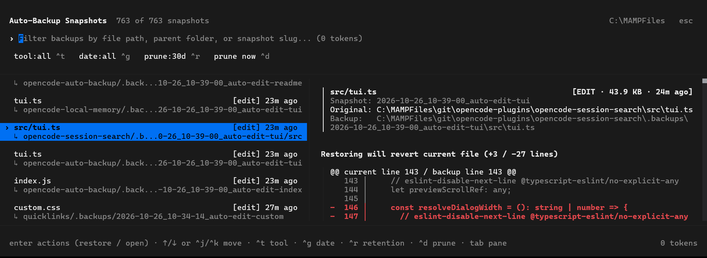

# opencode-local-backup

**Local-first, automatic pre-edit file backup plugin for OpenCode**: snapshots files automatically in the engine pipeline before any edit tool runs, with zero token usage, smart project-root resolution, retention auto-pruning, and an interactive `/backups` diff and restore TUI popup.



## Background

This plugin started as a PowerShell script (`backup.ps1`) paired with a rule in `AGENTS.md` instructing the model to run a shell backup command before editing any file. In daily use, that approach had three drawbacks:

1. **Every backup cost a tool call and model tokens**: The agent had to remember the rule, invoke the shell tool before editing, and wait for a child process to spawn.
2. **Prompt rules can be skipped after context compaction**: If the model forgot the instruction on a long turn, the file was edited without a snapshot.
3. **Subfolder pollution**: Passing a file's parent directory created `.backups/` folders inside nested subdirectories (`src/components/.backups/`, `api/.backups/`) instead of keeping all snapshots at the project root.

`opencode-local-backup` moves pre-edit backups into OpenCode's tool execution pipeline:

1. **Engine-level `execute.before` hook**: Intercepts `edit`, `write`, `patch`, `apply_patch`, and `multiedit` calls in pure Node.js before the tool touches disk, with zero prompt rules or LLM tokens.
2. **Smart project-root resolution**: Walks upward from the target file to the nearest project root marker so every snapshot lands in `<project-root>/.backups/`.
3. **Zero-token `/backups` TUI modal**: Filter snapshots, inspect a live hunk diff against the current file on disk, open a full side-by-side diff in VS Code, adjust auto-prune retention, and restore files with `Enter`.

## Features

| Feature | Details |
| :--- | :--- |
| Engine-level `execute.before` hook | Automatically snapshots existing files before `edit`, `write`, `patch`, `apply_patch`, or `multiedit` tool calls run |
| Local-first, zero-token execution | Pure local Node.js filesystem snapshots and TUI diff/restore with zero LLM token usage, zero prompt rules, and zero cloud dependencies |
| Smart project-root resolution | Walks upward to find `.git`, `package.json`, `composer.json`, `Cargo.toml`, `pyproject.toml`, `go.mod`, `.opencode`, `AGENTS.md`, `opencode.jsonc`, or `opencode.json` so all backups stay in `<project-root>/.backups/` instead of polluting nested subfolders |
| Preserved relative paths | Stores `<project-root>/.backups/<YYYY-MM-DD_HH-mm-ss>_<slug>/<relative-path>` plus `.backup-meta.json` |
| Multi-file patch support | Extracts every `*** Update File:`, `*** Delete File:`, and `*** Move File:` entry in a patch |
| Interactive `/backups` TUI modal | Wide (`80%` default, configurable via `dialogWidth`) split-pane browser with colored filter pills (`^t` tool, `^g` date, `^r` retention, `^d` prune), parent backup path under each item, hunk-filtered unified diff preview with line numbers, and a 3-option `Enter` action popup (**[1] Restore file**, **[2] Open backup file**, or **[3] Open diff in editor**) |
| Instant hunk diff + external editor diff | Right-hand pane immediately renders changed hunks (`±3` context lines + line numbers), while action `[3]` (`D`) launches `code --diff <backup> <current>` (or `$OPENCODE_BACKUP_DIFF_CMD`) for a full side-by-side comparison |
| Unlimited workspace discovery (`rootDir`) | Scans all `.backups/` folders across your workspace with no depth cap (`Infinity`) and no snapshot count cap, configurable via `rootDir` in `~/.config/opencode/auto-backup.json` or automatic workspace-root detection |
| Pre-restore safety snapshot | Restoring a file automatically backs up the current file on disk first (`pre-restore`) |
| Configurable auto-prune (`retentionDays`) | Defaults to `30` days; set to `5`, `7`, `14`, or `0` (never auto-prune) via `~/.config/opencode/auto-backup.json`, `/backups` (`Ctrl+R`), CLI, or plugin options |

## Installation

### Option 1: One-Command Install (Recommended)

Run the built-in installer to automatically register the server and TUI plugins in `~/.config/opencode/opencode.jsonc` and `~/.config/opencode/cli.json`:

```sh
npx github:nandoblanco/opencode-local-backup install
```

Or set a custom workspace root directory for `.backups/` discovery during setup:

```sh
npx github:nandoblanco/opencode-local-backup root "C:\MAMPFiles"
```

You can also install with OpenCode's native plugin CLI (because `package.json` exports both `.` and `./tui`, OpenCode loads both the server plugin and `/backups` TUI popup automatically):

```sh
opencode plugin add opencode-local-backup
# or directly from GitHub:
opencode plugin add github:nandoblanco/opencode-local-backup
```

### Option 2: Manual Configuration

Add `opencode-local-backup` to `~/.config/opencode/opencode.jsonc` and `~/.config/opencode/cli.json`:

```jsonc
{
	"plugins": [
		{
			"package": "opencode-local-backup",
			"options": {
				"retentionDays": 30,
				"debounceMs": 0,
				"rootDir": "C:\\MAMPFiles",
				"dialogWidth": "80%"
			}
		}
	]
}
```

### From a Local Directory

Clone this repository and run `node ./index.js install` (or reference `"file:///path/to/opencode-local-backup"` in `opencode.jsonc` and `cli.json`):

```json
{
	"plugins": ["file:///path/to/opencode-local-backup"]
}
```

## Usage

### Automatic Pre-Edit Backups (Server Hook & Tools)

Once enabled, the plugin snapshots files automatically during normal coding sessions:

- **Automatic Pre-Edit Snapshots (`execute.before` hook)**: Before `edit`, `write`, `patch`, `apply_patch`, or `multiedit` modifies an existing file on disk, the plugin copies the unmodified file into `<project-root>/.backups/<YYYY-MM-DD_HH-mm-ss>_<slug>/<relative-path>`.
- **Agent Tools (`backup_list` & `backup_restore`)**: You can also ask the agent in chat to list or restore recent backups if needed.

### Zero-Token TUI Commands

1. **Interactive `/backups` popup**: Run `/backups` (aliases: `/backup`, `/restore`, `/snapshots`) or `/backups <query>` to open the split-pane snapshot browser.
2. **Command palette**: Press `Ctrl+P` and select `Browse & restore file backups (0 tokens)...`.
3. **Custom keybind**: Bind `auto.backup.browse` in `~/.config/opencode/cli.json` (the one-command installer binds `ctrl+alt+b` by default):

```json
{
	"keybinds": {
		"auto.backup.browse": "ctrl+alt+b"
	}
}
```

## TUI Query Syntax (`/backups`)

Type search terms in the search bar to filter across all discovered snapshots, or combine them with the interactive filter pills (`^t` tool, `^g` date, `^r` retention).

| Syntax | Description | Example |
| :--- | :--- | :--- |
| `term1 term2` | Multi-term AND substring match across relative file path, `.backups` folder path, original path, project root, snapshot ID, and slug | `butte index.html` |
| `<filename>` | Filter snapshots for a specific file name or extension | `tui.ts` |
| `<project-folder>` | Filter snapshots belonging to a specific project or client subfolder | `winnipeg` |
| `auto-edit` / `pre-restore` | Filter snapshots by slug or tool prefix (or press `Ctrl+T` to cycle the `tool:` pill) | `pre-restore` |

## Keyboard Shortcuts (`/backups`)

| Key | Action |
| :--- | :--- |
| `Enter` | Open the 3-option Action Popup for the selected snapshot: **[1] Restore file**, **[2] Open backup file**, or **[3] Open diff in editor** |
| `1` / `R` *(in action popup)* | Restore selected snapshot to disk (creates a `pre-restore` safety backup first) |
| `2` / `O` *(in action popup)* | Open the snapshot file in your default OS editor (or `$OPENCODE_BACKUP_EDITOR` / `$VISUAL` / `$EDITOR`) |
| `3` / `D` *(in action popup)* | Open a side-by-side diff (`backup` vs `current` on disk) in VS Code (`code --diff`) or `$OPENCODE_BACKUP_DIFF_CMD` |
| `Up` / `Down` or `Ctrl+K` / `Ctrl+J` | Select snapshot (or scroll diff by 2 lines when Preview pane is focused; `j`/`k` also work in List and Preview panes) |
| `PageUp` / `PageDown` | Jump 6 snapshots up/down (or scroll diff by 8 lines in Preview pane) |
| `Tab` / `Shift+Tab` | Switch focus between Search Input, Snapshots List, and Diff Preview Pane |
| `Ctrl+T` | Cycle tool filter pill (`all` -> `edit` -> `write` -> `patch` -> `pre-restore`) |
| `Ctrl+G` | Cycle date filter pill (`all` -> `24h` -> `7d` -> `30d`) |
| `Ctrl+R` | Cycle auto-prune retention pill (`30d` -> `14d` -> `7d` -> `5d` -> `0d (Never)`) |
| `Ctrl+D` | Prune snapshots older than current `retentionDays` |
| `Ctrl+U` | Clear the active search query and reset tool/date filters |
| `Esc` | Close action popup or modal |

## How It Works (Architecture & Internals)

### 1. Pre-Edit Interception & Target File Extraction (`execute.before` & `extractTargetFiles`)

During server plugin setup (`createPluginDefinition()`), `ctx.tool.hook("execute.before")` registers a synchronous-fast listener that checks `event.tool` against `EDIT_TOOLS`:

```js
const EDIT_TOOLS = new Set(["edit", "write", "patch", "apply_patch", "multiedit"]);
```

When one of those tools is about to run, `extractTargetFiles(toolName, event.input, workspaceDir)` normalizes and deduplicates every target file path across OpenCode's different tool schemas:

- **Single-file fields**: `input.filePath` and `input.path`
- **Multi-file arrays**: `input.files[]` and `input.edits[]` (accepting raw path strings or objects with `.filePath` / `.path`)
- **Unified patch payloads**: `input.patchText` and `input.patch`, parsed by `extractPatchedPaths()` using `/^\*\*\*\s+(?:Update|Delete|Move)\s+File:\s*(.+)$/gm` so every updated, deleted, or moved file in a multi-file patch is captured before the patch applies

Only files that already exist on disk (`fs.existsSync(abs)` and `st.isFile()`) are snapshotted. Newly created files are ignored, and the entire backup call is wrapped in a `try / catch` so a transient filesystem lock never blocks tool execution.

### 2. Smart Project-Root Resolution (`resolveProjectRoot`)

Rather than placing `.backups/` inside the edited file's immediate parent folder, `resolveProjectRoot(filePath, workspaceDir)` walks upward from `path.dirname(absFile)` toward `workspaceDir`:

1. At each directory level, it checks `PROJECT_MARKERS` in order:
   ```js
   const PROJECT_MARKERS = [
   	".git",
   	"package.json",
   	"composer.json",
   	"Cargo.toml",
   	"pyproject.toml",
   	"go.mod",
   	".opencode",
   	"AGENTS.md",
   	"opencode.jsonc",
   	"opencode.json",
   ];
   ```
2. As soon as a directory contains any marker in `PROJECT_MARKERS`, that directory is selected as the project root (`<project-root>/.backups/`).
3. **Workspace boundary guard (`isSubPath`)**: The upward walk stops if it reaches `workspaceDir` or if the next parent directory would step outside `workspaceDir`, preventing stray `.backups/` folders in parent directories above the active workspace.
4. **Monorepo grouping**: If a single multi-file patch or `multiedit` call touches files across multiple subprojects, the `execute.before` hook groups the target files by their resolved root (`byRoot` map) and writes one snapshot per subproject root.

### 3. Snapshot Layout, Relative Paths & Per-File Debouncing (`createBackupSnapshot`)

For each resolved root, `createBackupSnapshot()` builds a timestamped snapshot folder `<YYYY-MM-DD_HH-mm-ss>_<slug>`:

- **Slug naming**: Single-file hook backups use `auto-<tool>-<basename>` (for example, `2026-10-26_14-22-05_auto-edit-index`), while multi-file hook backups use `auto-<tool>-<N>-files` (`2026-10-26_14-22-05_auto-apply-patch-3-files`). If another snapshot occurred within the same second, it appends `-2`, `-3`, etc.
- **Preserved relative tree**: Each file's path relative to `rootDir` (`path.relative(rootDir, absFile)`) is recreated inside the snapshot folder (`<project-root>/.backups/<snapshotId>/src/components/Button.tsx`) and copied with `fs.copyFileSync()`.
- **Per-file debounce (`lastFileBackupMap`)**: An in-memory `Map<absFilePath, timestampMs>` tracks when each file was last backed up. When `debounceMs > 0` and `force` is not set, edits to the same file within `debounceMs` skip creating redundant snapshots. Manual CLI backups and `pre-restore` snapshots pass `force: true` to bypass debounce.
- **Metadata manifest (`.backup-meta.json`)**: Writes a JSON manifest alongside the copied files recording the snapshot `id`, ISO `timestamp`, epoch `timeMs`, `slug`, `tool`, `root`, and the `files[]` array (`relativePath`, `originalPath`, `size`, `mtimeMs`).

### 4. Throttled Auto-Pruning & Settings Precedence (`pruneOldBackups` & `resolveRetentionDays`)

`resolveRetentionDays()` determines the active retention window using a three-step precedence order:

1. Explicit `retentionDays` option passed to the plugin in `opencode.jsonc` or CLI argument
2. `OPENCODE_BACKUP_RETENTION_DAYS` environment variable
3. Persistent settings file `~/.config/opencode/auto-backup.json` (or `$XDG_CONFIG_HOME/opencode/auto-backup.json`), read and updated via `readBackupSettings()` and `writeBackupSettings()` (defaults to `{ "retentionDays": 30, "debounceMs": 0 }`)

To avoid scanning `.backups/` on every edit, `createBackupSnapshot()` throttles automatic pruning per project root using `lastRootPruneMap` and `PRUNE_INTERVAL_MS` (`10 * 60 * 1000`, or once every 10 minutes per root).

When pruning runs (`pruneOldBackups(rootDir, retentionDays)`):

- If `retentionDays <= 0`, auto-pruning is disabled (`disabled: true`) and all snapshots are kept indefinitely.
- Otherwise, it computes `cutoffMs = Date.now() - days * 86400000` and inspects each subdirectory in `.backups/`.
- Snapshot age is parsed directly from the folder name prefix via `parseFolderTimestamp()` (`/^(\d{4})-(\d{2})-(\d{2})_(\d{2})-(\d{2})-(\d{2})_(.+)$/`), falling back to `fs.statSync(fullDir).mtimeMs` for custom folder names, and expired folders are removed with `fs.rmSync(fullDir, { recursive: true, force: true })`.

### 5. Multi-Root Discovery, Hunk-Filtered Unified Diff, Safe Restore & Editor Launch (`listBackups`, `computeUnifiedDiff`, `restoreBackupFile`, `openBackupFile`, `openBackupDiff`)

1. **Workspace & subproject discovery (`resolveScanRootDir`, `resolveTopWorkspaceRoot`, `collectBackupRoots`, `listBackups`)**:
   - Determines the starting scan root via `resolveScanRootDir()`: checks `OPENCODE_BACKUP_ROOT_DIR`, then `rootDir` in `~/.config/opencode/auto-backup.json`, and otherwise walks upward (`resolveTopWorkspaceRoot`) to the highest workspace ancestor containing `.backups`, `AGENTS.md`, or `.opencode`.
   - When `includeSubprojects: true` is enabled (used by `/backups` and `backup_list`), recursively scans from the scan root with no depth cap (`Infinity` by default, while skipping `node_modules`, `.git`, `.screenshots`, `xampp`, `vendor`, `.next`, `dist`, `build`, `.cache`, `bower_components`, and dot-directories) and no default snapshot count limit (`limit: 0`) so every `.backups/` folder across deeply nested client and project directories is indexed.
   - Reads `.backup-meta.json` when present and falls back to `walkSnapshotFiles()` so snapshots created by older scripts without `.backup-meta.json` still appear in `/backups`.
2. **Zero-dependency hunk-filtered unified diff (`computeUnifiedDiff`)**:
   - Compares the backup file against the live file on disk (`originalPath`) and classifies the state as `identical`, `modified`, `deleted` (file was removed from disk after the backup), `binary`, or `missing-backup`.
   - For modified files, runs a 25-line lookahead window (`for (let look = 1; look <= 25; look++)`) comparing `oldLines` (current file on disk) and `newLines` (backup snapshot) to produce a full `rawOps` stream (`same`, `add`, `del`) with 1-based line numbers (`oldLine`, `newLine`).
   - Instead of emitting unchanged lines from line 1 of the file, `computeUnifiedDiff` marks only changed indices (`add` / `del`) plus a `±3` line context window (`contextLines = 3`), inserting `@@ current line X / backup line Y @@` hunk headers between non-contiguous change regions and formatting each line with its padded line number (`  42 │ ...`, `+ 42 │ ...`, `- 42 │ ...`).
3. **Pre-restore safety backup (`restoreBackupFile`)**:
   - Before copying the selected backup file back to `originalPath`, `restoreBackupFile()` checks whether `targetPath` currently exists on disk and automatically creates a `pre-restore` snapshot (`tool: "restore", force: true`). If you restore the wrong snapshot, the state from right before the restore is immediately available at the top of `/backups`.
4. **Open backup file in external editor (`openBackupFile`)**:
   - Launches the raw snapshot file from `.backups/` as a detached process using `OPENCODE_BACKUP_EDITOR`, `$VISUAL`, or `$EDITOR` when set, or falls back to the OS default file handler (`cmd /c start ""` on Windows, `open` on macOS, `xdg-open` on Linux).
5. **Open side-by-side diff in external editor (`openBackupDiff`)**:
   - Launches a side-by-side comparison of `backupFilePath` vs `currentFilePath` as a detached process using `OPENCODE_BACKUP_DIFF_CMD` when configured, or `code --diff <backup> <current>` (VS Code) by default (`cmd /c code --diff ...` on Windows).

### 6. Interactive OpenTUI `/backups` Modal Architecture (`tui.ts`)

1. **Wide modal layout (`applyDialogWidth` & `dialog.set`)**:
   - Calls `context.ui.dialog.show(...)` followed by `context.ui.dialog.set({ size: "xlarge", centered: true })` (calling `dialog.set` after `dialog.show` prevents `dialog.show` from resetting the dialog size to default).
   - Inside `onMount` and `createEffect`, `applyDialogWidth()` walks upward from `rootRef` to the outer `absolute`-positioned dialog container to set `width: "80%"` (or your configured `dialogWidth`), `maxWidth: "80%"`, and `minWidth: 76`.
2. **Filter pills & multi-pane navigation**:
   - Renders interactive `Pill` components beneath the search input for `tool:<filter>` (`^t`), `date:<filter>` (`^g`), `prune:<days>` (`^r`), and `prune now` (`^d`), clickable by mouse or keyboard shortcut.
   - Splits the main body into a 44%-width left snapshot list (showing `relativePath`, colored `[tool]` badge, relative age, and `↳ <project>/.backups/<snapshotId>` parent path) and a 56%-width right preview pane (left-bordered metadata card + syntax-colored hunk diff lines with search-term highlighting).
3. **`@opentui/solid` `Show` isolation for the 3-option Action Popup**:
   - Pressing `Enter` on a snapshot opens the inline Action Confirmation Sub-Popup (`[1] Restore file`, `[2] Open backup file`, `[3] Open diff in editor`).
   - In `@opentui/solid`, placing a reactive `createComponent(Show, ...)` directly inside a multi-child parent via `insert(node, child)` (without a marker node) causes `cleanChildren()` to clear all sibling children when `Show` transitions from `true` back to `false`. Wrapping `Show` inside its own dedicated single-child container `el("box", { flexDirection: "column", flexShrink: 0 }, createComponent(Show, ...))` ensures closing the sub-popup only clears that inner wrapper box.

### 7. Agent Tools Registered by the Server Plugin

| Tool Name | Required Inputs | Optional Inputs | Behavior |
| :--- | :--- | :--- | :--- |
| `backup_list` | *(none)* | `query`, `limit` (default `20`) | Scans the workspace and subprojects (`includeSubprojects: true`), filters by `relativePath`, `snapshotId`, or `slug`, and returns matching entries sorted newest-first. |
| `backup_restore` | `snapshotId` | `relativePath` | Creates a `pre-restore` safety snapshot of the current file on disk, then copies the snapshot file back to its original path. |

### 8. Token Usage Breakdown

Normal backup, diff preview, and restore operations use zero LLM tokens:

| Operation | Token Cost | Why |
| :--- | :--- | :--- |
| Automatic pre-edit backups (`execute.before` hook) | **0 tokens** | Runs in plain Node.js inside OpenCode before `edit`, `write`, `patch`, `apply_patch`, or `multiedit` touches disk; injects no system prompt rules and appends nothing to chat |
| Interactive `/backups` TUI modal (`Ctrl+Alt+B`) | **0 tokens** | Filtering snapshots, computing hunk diffs (`computeUnifiedDiff`), restoring files (`1`), opening files/diffs (`2`/`3`), cycling retention (`Ctrl+R`), and pruning (`Ctrl+D`) run directly on disk without an LLM request |
| Standalone CLI (`npx opencode-local-backup ...`) | **0 tokens** | Runs directly in Node.js outside the model turn |
| Agent tools (`backup_list`, `backup_restore`) | **~120 schema tokens** (+ turn tokens only if called) | Tool definitions are registered with the server so you can ask the agent to list or restore a snapshot in chat; using `/backups` instead avoids calling these tools |

## Directory Structure

```text
<project-root>/
└── .backups/
    ├── 2026-10-26_14-22-05_auto-edit-index/
    │   ├── .backup-meta.json
    │   └── src/
    │       └── index.js
    └── 2026-10-26_14-35-12_pre-restore/
        ├── .backup-meta.json
        └── src/
            └── index.js
```

Each snapshot's `.backup-meta.json` stores the file manifest used by `/backups` and `backup_list`:

```json
{
	"id": "2026-10-26_14-22-05_auto-edit-index",
	"timestamp": "2026-10-26T19:22:05.118Z",
	"timeMs": 1793052125118,
	"slug": "auto-edit-index",
	"tool": "edit",
	"root": "/path/to/project",
	"files": [
		{
			"relativePath": "src/index.js",
			"originalPath": "/path/to/project/src/index.js",
			"size": 4820,
			"mtimeMs": 1793051900412.5
		}
	]
}
```

## CLI Commands

```sh
# Install into OpenCode server + TUI config
npx opencode-local-backup install

# List recent backups in the current project
npx opencode-local-backup list

# Create a manual snapshot of specific files
npx opencode-local-backup backup my-change-slug src/index.js src/config.js

# View or set auto-prune retention days (0 = never auto-prune, default = 30)
npx opencode-local-backup retention
npx opencode-local-backup retention 5
npx opencode-local-backup retention 0

# View, set, or clear the starting root directory for scanning .backups/ folders
npx opencode-local-backup root
npx opencode-local-backup root "C:\MAMPFiles"
npx opencode-local-backup root --clear

# Prune snapshots older than 30 days
npx opencode-local-backup prune . 30
```

## Configuration Options

Settings are stored in `~/.config/opencode/auto-backup.json` (created automatically with `"retentionDays": 30, "debounceMs": 0, "rootDir": "", "dialogWidth": "80%"`) and can also be passed via `opencode.jsonc` / `cli.json` plugin options or environment variables:

```json
{
	"retentionDays": 30,
	"debounceMs": 0,
	"rootDir": "C:\\MAMPFiles",
	"dialogWidth": "80%"
}
```

| Option | Env Variable | Default | Description |
| :--- | :--- | :--- | :--- |
| `retentionDays` | `OPENCODE_BACKUP_RETENTION_DAYS` | `30` | Days to keep backup snapshots before auto-pruning (`0` = never auto-prune) |
| `debounceMs` | `OPENCODE_BACKUP_DEBOUNCE_MS` | `0` | Minimum milliseconds between automatic snapshots of the same file (`0` = every single edit) |
| `rootDir` | `OPENCODE_BACKUP_ROOT_DIR` | `""` *(auto-detect)* | Starting root directory for discovering all `.backups/` folders across subprojects (`npx opencode-local-backup root <path>`) |
| `backupRoot` | `OPENCODE_BACKUP_ROOT` | *(auto)* | Optional fixed destination directory where new `.backups/` snapshots are written instead of per-project root detection |
| `dialogWidth` | `OPENCODE_BACKUP_DIALOG_WIDTH` | `"80%"` | Width of the centered `/backups` TUI modal (`"80%"` or column count like `120`; also respects `OPENCODE_DIALOG_WIDTH`) |
| *(editor)* | `OPENCODE_BACKUP_EDITOR` | `$VISUAL` / `$EDITOR` / OS default | Command used when choosing **[2] Open backup file** in the `/backups` action popup |
| *(diff cmd)* | `OPENCODE_BACKUP_DIFF_CMD` | `code --diff` | Command used when choosing **[3] Open diff in editor** (`backup` vs `current` on disk) |

## License

MIT
